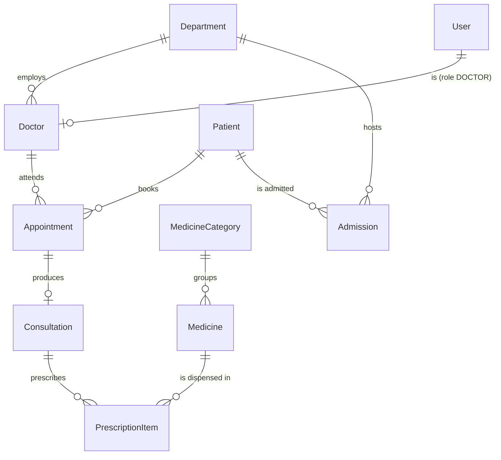

<div align="center">

# 🏥 Hospital Management API

**A layered, role-based REST API for running a hospital: departments, doctors, patients,
appointments, consultations, admissions, pharmacy stock and prescriptions.**


</div>

---

## Overview

This API is the backend of a hospital management system. It was ported from a Next.js Server-Actions
monolith into a standalone service with **strict separation of concerns**:

```
routes  →  middlewares (authenticate · authorize · validate · rateLimit)  →  controllers  →  services  →  models  →  Prisma
```

| Layer | Responsibility |
| --- | --- |
| **routes** | URL, allowed roles, and the validation schema. Nothing else |
| **middlewares** | JWT verification, RBAC, Zod validation, rate limiting, central error handling |
| **controllers** | Read `req`, call one service, shape the response. No business logic |
| **services** | Business rules, e.g. a doctor must belong to the department and a patient can't be admitted twice |
| **models** | Every Prisma query lives here, and nothing else touches the DB |
| **validations** | Zod schemas shared with the original frontend |

## Domain



**Roles:** `ADMIN` · `RECEPTIONIST` · `DOCTOR`.
**Highlights:** a live dashboard (stats, notifications, recent appointments), low-stock and
expiring-medicine alerts, appointment status workflow, admission / discharge, and secure file storage
through S3 **presigned URLs**.

## Security

| Concern | Implementation |
| --- | --- |
| Passwords | `bcrypt` (cost 10), 8–72 chars (bcrypt's real input limit), never returned by any query |
| Tokens | JWT `HS256` pinned on both sign and verify, so algorithm-confusion attacks don't work. The signing secret length is checked in production |
| Authorization | `authenticate` + `authorize(...roles)` per route. Destructive operations are admin-only |
| Privilege escalation | Public registration can never create an `ADMIN`. It can be closed entirely with `ALLOW_SELF_REGISTRATION=false` |
| Brute force | IP rate limiting on `/auth/login` and `/auth/register` (10 attempts / 15 min, standard `RateLimit-*` headers) |
| User enumeration | Constant-time login: unknown emails still run a bcrypt compare |
| Input | Every body and query is parsed with Zod, unknown keys are stripped, emails are normalised |
| Uploads | Server-generated UUID keys (the client filename is never trusted), content-type allow-list (no HTML/SVG), 10 MB cap, path-traversal guard on keys |
| Transport | `helmet` headers, configurable CORS allow-list (`CORS_ORIGIN`), 1 MB JSON body cap |
| Errors | One error handler. Prisma codes map to 404/409, and 5xx details are hidden in production |

## Getting started

```bash
git clone https://github.com/n1j10/backend-hospital-management.git
cd backend-hospital-management
npm install
cp .env.example .env              # set DATABASE_URL, JWT_SECRET, storage keys
npx prisma migrate deploy
npm run seed                      # optional demo data
npm run dev                       # http://localhost:5000/api/health
```

Seeded accounts: `admin@hospital.com` (ADMIN), `reception@hospital.com` (RECEPTIONIST),
`ali@hospital.com`, `sara@hospital.com`, … (DOCTOR). The demo password for all of them is in `prisma/seed.js`.

### Environment variables

| Variable | Required | Description |
| --- | :---: | --- |
| `DATABASE_URL` | ✅ | Postgres connection string (Neon serverless adapter) |
| `JWT_SECRET` | ✅ | ≥ 32 random chars |
| `JWT_EXPIRES_IN` | ➖ | Default `7d` |
| `AWS_ENDPOINT_URL_S3`, `AWS_ACCESS_KEY_ID`, `AWS_SECRET_ACCESS_KEY` | ✅ | S3-compatible storage |
| `AWS_REGION`, `AWS_BUCKET` | ➖ | Defaults `us-east-1`, `default-bucket` |
| `CORS_ORIGIN` | ➖ | Comma-separated allowed origins (empty = any) |
| `ALLOW_SELF_REGISTRATION` | ➖ | `false` closes public sign-up (default `true`) |

### Scripts

| Command | Purpose |
| --- | --- |
| `npm run dev` | Nodemon dev server |
| `npm start` | Production server |
| `npm test` | Unit tests (`node:test`, no extra dependency) |
| `npm run seed` | Seed demo data |
| `npm run prisma:migrate` | Create / apply a migration |

## API

Authenticate with `POST /api/auth/login`, then send the token on every request:

```http
Authorization: Bearer <token>
```

Every response uses the same envelope:

```json
{ "success": true,  "message": "Success", "data": {} }
{ "success": false, "message": "Patient not found" }
```

`user` = any logged-in role.

| Method | Path | Auth | Ported from |
| --- | --- | --- | --- |
| POST | `/api/auth/register` | – | `registerAction` |
| POST | `/api/auth/login` | – | `loginAction` |
| GET | `/api/auth/me` | user | `getCurrentUser` |
| GET | `/api/users` | admin | `fetchUsers` |
| DELETE | `/api/users/:id` | admin | `deleteUserAction` |
| GET | `/api/dashboard/stats` | user | `fetchDashboardStats` |
| GET | `/api/dashboard/notifications` | user | `fetchNavbarNotifications` |
| GET | `/api/dashboard/recent-appointments` | user | `fetchRecentAppointments` |
| GET | `/api/departments` | user | `fetchDepartments` (`?search=`) |
| GET | `/api/departments/select` | user | `fetchAllDepartmentsForSelect` |
| GET | `/api/departments/:id` | user | `fetchSingleDepartment` |
| POST | `/api/departments` | admin | `createDepartmentAction` |
| PATCH | `/api/departments/:id` | admin | `updateDepartmentAction` |
| DELETE | `/api/departments/:id` | admin | `deleteDepartmentAction` |
| GET | `/api/doctors` | user | `fetchDoctors` (`?search=`) |
| GET | `/api/doctors/select` | user | `fetchAllDoctorsForSelect` |
| GET | `/api/doctors/:id` | user | `fetchSingleDoctor` |
| POST | `/api/doctors` | admin | `createDoctorAction` |
| DELETE | `/api/doctors/:id` | admin | `deleteDoctorAction` |
| GET | `/api/patients` | user | `fetchPatients` (`?search=`) |
| GET | `/api/patients/select` | user | `fetchAllPatientsForSelect` |
| GET | `/api/patients/:id` | user | `fetchSinglePatient` |
| POST | `/api/patients` | user | `createPatientAction` |
| PATCH | `/api/patients/:id` | user | `updatePatientAction` |
| DELETE | `/api/patients/:id` | admin | `deletePatientAction` |
| GET | `/api/appointments` | user | `fetchAppointments` (`?search=&status=`) |
| GET | `/api/appointments/without-consultation` | user | `fetchCompletedAppointmentsWithoutConsultation` |
| GET | `/api/appointments/:id` | user | `fetchSingleAppointment` |
| POST | `/api/appointments` | user | `createAppointmentAction` |
| PATCH | `/api/appointments/:id/status` | user | `updateAppointmentStatusAction` |
| DELETE | `/api/appointments/:id` | admin | `deleteAppointmentAction` |
| GET | `/api/consultations` | user | `fetchConsultations` (`?search=`) |
| GET | `/api/consultations/:id` | user | `fetchSingleConsultation` |
| POST | `/api/consultations` | user | `createConsultationAction` |
| GET | `/api/admissions` | user | `fetchAdmissions` (`?search=&status=`) |
| GET | `/api/admissions/:id` | user | `fetchSingleAdmission` |
| POST | `/api/admissions` | user | `createAdmissionAction` |
| PATCH | `/api/admissions/:id/discharge` | user | `dischargePatientAction` |
| GET | `/api/categories` | user | `fetchCategories` |
| POST | `/api/categories` | admin | `createCategoryAction` |
| DELETE | `/api/categories/:id` | admin | `deleteCategoryAction` |
| GET | `/api/medicines` | user | `fetchMedicines` (`?search=&categoryId=`) |
| GET | `/api/medicines/low-stock` | user | `fetchLowStockMedicines` |
| GET | `/api/medicines/expiring` | user | `fetchExpiringMedicines` |
| GET | `/api/medicines/:id` | user | `fetchSingleMedicine` |
| POST | `/api/medicines` | user | `createMedicineAction` |
| PATCH | `/api/medicines/:id` | user | `updateMedicineAction` |
| DELETE | `/api/medicines/:id` | admin | `deleteMedicineAction` |
| POST | `/api/prescriptions` | user | `addPrescriptionItemAction` |
| DELETE | `/api/prescriptions/:id` | user | `removePrescriptionItemAction` |

**Storage** (`user`): `POST /api/storage/upload` (raw body, `?filename=&folder=`),
`POST /api/storage/upload-url`, `GET /api/storage/download-url?key=`, `DELETE /api/storage?key=`.

---

<div align="center">

Built by **[n1j10](https://github.com/n1j10)**

</div>
